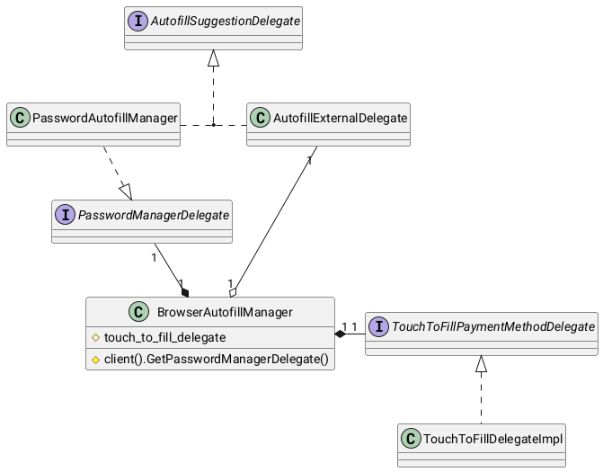
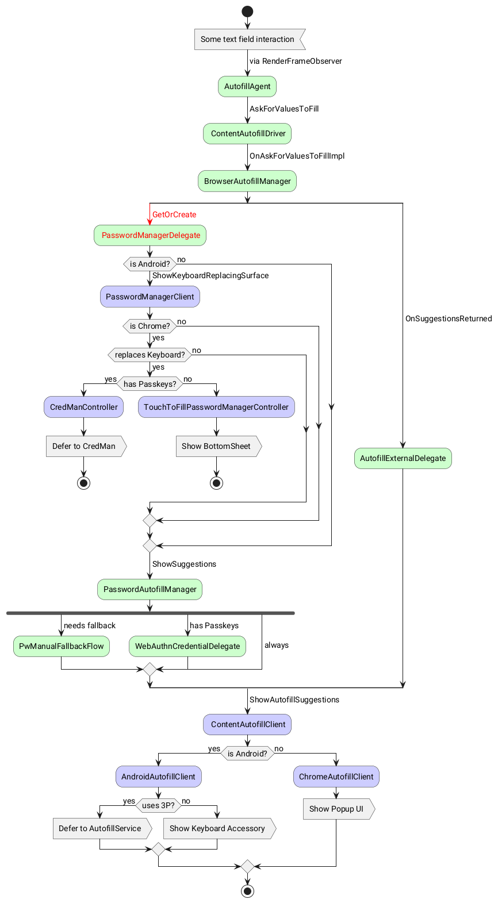

# Component Autofill Integrators

Interfaces in this folder are used for dependency injection from directories
that depend on `//components/autofill`.

## Class relationship of integrators to the BrowserAutofillManager

The following diagram describes how the `BrowserAutofillManager` uses different
delegates to compose suggestions from various sources into the autofill
dropdown.

Eventually, the `PasswordAutofillManager` shouldn't need to implement the
`AutofillSuggestionDelegate` because the BrowserAutofillManager will request and
dispatch suggestions through the delegate.

For some specific surfaces (and in the transitioning period), the
`BrowserAutofillManager` delegates the suggestion handling to the specific
delegate entirely. E.g. on Android, the password delegate handles the showing
of a keyboard-replacing surface when the `BrowserAutofillManager` invokes it:

